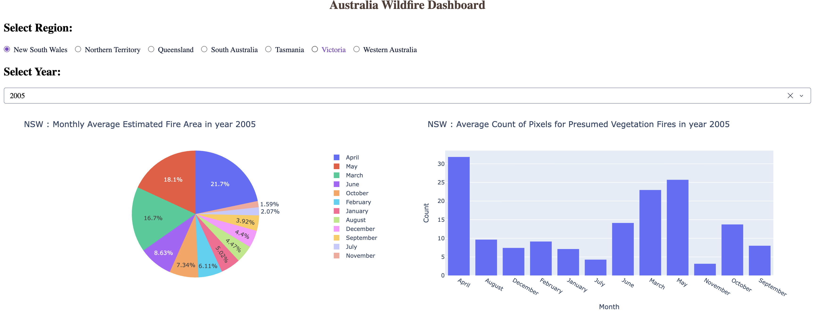

# Australia Wildfire Dashboard 🔥

An interactive data visualisation dashboard built using Python,
Dash, Plotly and Pandas to explore historical Australian wildfire
data across different regions and years.

## 📊 Dashboard Preview



## 📈 Data Visualisations

The dashboard includes two interactive visualisations:

### 1. Monthly Average Estimated Fire Area
- Interactive pie chart
- Shows the proportion of estimated fire area by month
- Updates according to the selected region and year

### 2. Monthly Average Vegetation Fire Pixel Count
- Interactive bar chart
- Compares average vegetation fire pixel counts across months
- Helps identify seasonal wildfire patterns

## ✨ Features

- Select from seven Australian regions
- Filter wildfire data by year (2005–2020)
- Interactive Plotly charts
- Automatic chart updates using Dash callbacks
- Data processing and aggregation using Pandas

## 🛠️ Technologies

- Python
- Pandas
- Plotly Express
- Dash
- HTML components

## 🚀 Getting Started

Clone the repository:

```bash
git clone https://github.com/YOUR-USERNAME/australia-wildfire-dashboard.git
cd australia-wildfire-dashboard
```

Install dependencies:

```bash
pip install pandas dash plotly
```

Run the application:

```bash
python Dash_wildfire.py
```

Open your browser at:

http://127.0.0.1:8050/

## 📁 Project Structure

```text
australia-wildfire-dashboard/
├── Dash_wildfire.py
├── README.md
├── requirements.txt
└── images/
    └── dashboard.png
```

## 📚 Dataset

Historical Australian wildfire data provided through
the IBM Data Visualisation course.

## 🎓 Acknowledgements

Developed as part of the IBM Data Visualisation with Python
course on Coursera, based on the course's practice assignment.

